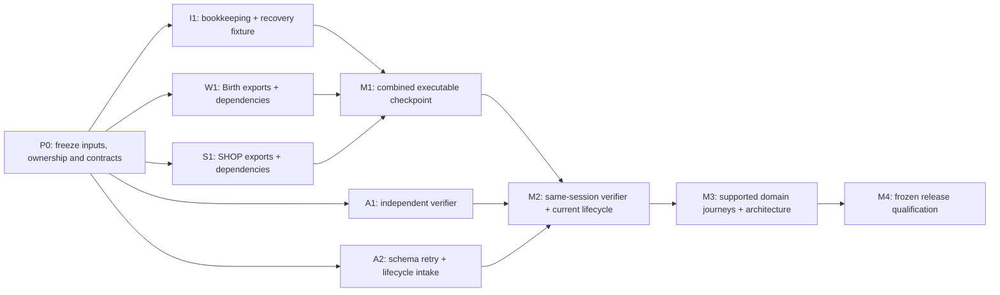

# Accounting completion plan: parallel delivery

## Active priority: October 19 accounting-off game; November 2 durable accounting

The human approved these separate targets on October 14, 2026. First freeze and
verify the accounting-off MySQL production game through normal core gameplay,
save/quit/relogin, link loss, full restart and independent UID/money/status readback.
Clean off play must not require the unfinished outcome journal, projector or
activation proof. Requested accounting that is unready, uncertain or recovery
pending must remain closed; it cannot silently fall back to off. Turning accounting
off never discards an acknowledged or unreconciled outcome. Production deployment
requires separate authorization.

The human adopted this contract on October 14, 2026. C++ world-thread RAM owns
live gameplay. Prepare the complete exact economic outcome and frozen RNG once,
preallocate publication, durably append it before positive acknowledgement,
publish once without yielding to world events, then project that same outcome
idempotently to MySQL. Unknown append fences the affected state until exact
reconciliation or recovery. Keep one ordered writer, a proved durable coupled
base plus retained outcome tail, bounded backlog, and admission before actual
player/pet/corpse/locker materialization. Late snapshots cannot reclaim later
custody or resurrect retired items. SQL projection does not grant live permission.

Valid loot and persistent-pet/NPC transfers use actual RAM UID, actor/control and
complete holder/subtree identity. Repair only unambiguous derived-cache drift;
missing or stale SQL/cache owner/revision alone cannot reject a valid operation.
Preserve genuine duplicate UID, wrong holder/master, malformed forest, tombstone,
escrow/auction/collector, conflicting replay and pending/uncertain guards.

Use the approved 13 project chats: the eleven existing owners plus Test
Infrastructure and Integration Preparation. Test Infrastructure repairs genuine
test dependencies, runners and cleanup; Integration Preparation assembles exact
accepted patches and build inputs. Keep exclusive function leases, one integrator
with sole publication and ABI authority, and one owned heavy-job queue. Through
October 17, execute the off batch and repair actual
regressions while RAM implementation continues. Freeze and stabilize the off
candidate on October 18 for the October 19 target. Complete core RAM/MySQL coupling
and fault/recovery paths on October 20–25, then independently verify and stabilize
through November 1 for the November 2 accounting target. Dates do not manufacture
completion. Accounting requires a maintained production build, genuine core player journeys,
independent immutable-source review, durable money/item/status reconciliation,
replay/conflict/stale refusal, unknown append/projection outage, relog/reconnect
and full restart. Map R1–R8 conservation, recovery and resource obligations to
this RAM contract; retire superseded SQL-as-permission and second AFTER-save/ACK
proofs. A reduced enabled route set requires explicit scope approval.

Preserve historical source/authorship, divergent packets and all original evidence.
Defer flatfile/SpacetimeDB implementation, exhaustive suite and optional old
bridge/matrix campaigns. No production or receiving-fork writes, deployment,
migration/wipe or history cleanup is included. Publish required plan changes
with coherent substantive implementation/tests, never as a communication commit.


The supported MySQL schema64 profile is explicit in `migrations/migration_manifest.schema64.json`, the exact first 64 entries of the default immutable history. Backup and restore retain and validate that selector. New backup generations use version 2; the reader also preserves the original exact version 1 archive profile. Schema65 measurement and qualification remain separate and unclaimed.

## Historical priority: superseded MySQL code-first marathon

The human approved this sprint on 2026-10-13, from 20:22 MDT that day through
20:22 MDT on 2026-10-14, using the same eleven accounting sessions. First complete
one authentic existing operation through retained ownership, coupled MySQL effects
and receipt, Save/worker completion, native publication, acknowledgement and restart;
then reuse that connected path across the required core gameplay. Delegate bounded
shared-code sections while retaining one integration publisher and one heavy-job queue.

Defer new flatfile qualification, the full suite, the second SQL-engine release matrix,
SpacetimeDB expansion and optional refactors to the follow-on queue. Preserve running
owned jobs through safe completion and cleanup. Required checkpoint checks remain an
actual MySQL-linked build and fresh boot/admission, nonempty core player journeys,
independent durable read-back, replay/uncertain-operation controls, reconnect and restart.
Source, writer, lifecycle and currentness proof and original runtime guards still apply.
At the deadline report the actually validated candidate and exact blocked routes; keep
admission closed if its proof is incomplete. Resume remaining core correctness and then
deferred backend/full qualification afterward. R1–R8 remain the full release contract.

Deliver one executable combined candidate, then finish the supported gameplay,
architecture and independent release gates in bounded parallel lanes. This plan
was prepared on 2026-10-11 and approved for execution on 2026-10-12 from cleanup source
`c8452833c5e2d4819341a144444dd9638c4fe78d` and the paused handoff at
`11ea970dc616a04069cda703d3afe9cc02b4c7d1`. The maintained implementation base
is `f215679503d787a25af52fa8103506159a50013d`.

The user approved preparing the 330-document archive and asked for a faster
multi-agent completion plan. Implementation resumes under the ownership and acceptance gates below. Accounting remains INACTIVE, admission CLOSED, coverage INCOMPLETE and
release BLOCKED. R1–R8, the [five domain plans](DELIVERY_PLAN.md), required
responsibility boundaries and existing product decisions remain required.
Historical Plan 1 acceptance retains only its recorded scope. Technical completion
does not authorize activation, production operations, deployment or PR merge.

Bandage healing and caster vitality changes now enter the existing persistent
STATUS capture, and poison removal enters AFFECTS capture even when no healing
follows. The original event arithmetic, random selection, healing caps,
interruptions and durable bandage retirement remain unchanged. The focused
regression executes the original event and damage modifier with native revision
tracking; it does not establish coupled effect receipts, cold recovery or ACK.

Saved SHOP catalog destinations are now checked together before current custody
is installed. An invalid destination discards the complete unpublished stock and
returns failure, preserving incumbent keepers. Original equipment effects and
restore guards remain unchanged. Twelve focused legacy fixture cases and both
affected production builds passed; this does not qualify nonempty custody,
accounting activation, full native recovery or publication ACK.

Bounded native quest recovery codecs now distinguish an actual allocation
callback refusal from semantic invalidity and account for each resident callback
probe throughout nested operations. The canonical regression uses the complete
original providers and passed; both affected production builds passed on identical
production sources. This inactive codec prerequisite does not qualify gameplay,
accounting activation, full Source65, native recovery or publication ACK.

## Starting facts and reusable inputs

- Read the [complete paused handoff](https://github.com/Community-Duris/Duris/blob/codex/accounting-handoff-context-20261012/docs/persistence/economy_accounting/SHARED_IMPLEMENTATION_PAUSED_HANDOFF_2026-10-11.md).
  Its [29-file shared patch](https://github.com/Community-Duris/Duris/blob/codex/accounting-handoff-context-20261012/docs/persistence/economy_accounting/paused-handoff-20261011/shared-candidate.patch) and
  [fingerprints](https://github.com/Community-Duris/Duris/blob/codex/accounting-handoff-context-20261012/docs/persistence/economy_accounting/paused-handoff-20261011/CANDIDATE.json) are proposals, not installed
  or compiled implementations. The patch excludes the WORLD/SHOP leased files.
- Birth, SHOP and ROOM now supply passive Source, INITIAL and query exports
  with focused supported/refusal profile controls. These interfaces close the
  metadata dependency; the full descendant/caller and nonempty runtime closure
  remains required before shared accounting qualification.
- Boot currently has the verification interval between `complete_boot()` and
  `before_world_callbacks()`; its genuine independent verifier invocation is missing.
- The [recovery runner patch](https://github.com/Community-Duris/Duris/blob/codex/accounting-handoff-context-20261012/docs/persistence/economy_accounting/paused-handoff-20261011/recovery-runner.patch) adds
  three omitted real providers to an existing fixture. It is independently runnable
  after deliberate rebind/review and does not depend on the seven exports.
- The starting coverage contract had 54/57 passing cases: a stale bandage anchor,
  ambiguous room-payload selector and stale `tests/run_test_entry.py` hash. The
  scoped passive package now passes all 57 source-contract checks; census and
  runtime/backend coverage remain incomplete, and release remains blocked.
  The missing-main adapter implementation was already fixed at `c72a56041`.
- Plan 5 `52ca6d9fba8da46bb63c1ce4d2da328e6bf6ab29` retains a failed full schema65
  matrix on `a60f5dcc...`, a later focused DIAG-02 pass, and prepared RETRY-03
  using native Linux MariaDB storage. No completed full retry is reported.
  The historical `.ibd` rename failure is not proof of a current migration-code defect.
- Original retention and restore runners pin schema61 and schema62; default ends
  at schema65. The original65 and nullable-default65 selectors are distinct.
  Preserve their historical meanings and qualify the genuine current route.
- Retain all dirty work, source packets, failed runs and original evidence. The
  handoff's three excluded files remain protected. Divergent helper branches are
  intake sources, not permission for a wholesale merge. The sibling notebook is
  retained; this plan does not claim to update or verify that private overlay.

## Four active owners, one integration writer

Use one integrator and three bounded delivery owners. The integrator is the
existing primary or an explicitly approved successor, never both. Reconcile
stopped-owner leases and exact branch/dirty state before resumption. Use the accepted four-owner team after source intake and exclusive file leases.

| Lane | Exclusive write set | First deliverable |
| --- | --- | --- |
| Integrator | Shared Save/worker, Coordinator, Item movement, Zone/shared budget, boot/lifecycle integration, `src/Makefile`, registration and writer metadata | Repair current acceptance bookkeeping; qualify independent recovery fixture; join one complete candidate |
| WORLD/Birth | `src/world/db.c`, `src/world/quest_mobile_native_birth.c/.h` | Three genuine birth exports and actual dependency/caller proof |
| SHOP/backend | `src/economy/shop_trade_transaction.c/.h`, `src/sql/sql_player.c`, `src/flatfile/flatfile_item_repository.c/.h` | Four genuine replay exports and Source/INITIAL/query proof |
| Independent Plan 5 | Existing read-only audit/operator/verifier/lifecycle scripts and explicitly inventoried fixtures; one genuine native verifier implementation through the existing ABI | Independent initialized-world correspondence plus coherent schema65/retention/restore acceptance |

The Plan 5 native verifier's exact implementation file is selected and exclusively
leased in task P0 after checking the existing native reader layout. Its shared
callback type, build registration, boot glue and mutation/lifecycle transaction
remain integrator-owned. Do not invent a second authority, new callback ABI or
parallel public permits. Required changes outside a lane's lease return as one
narrow contract request naming fields/functions, invariants, consumers and tests.

The integrator owns integration and the heavy-job queue as part of implementation.
A fifth permanent coordination/research agent is unnecessary. Source work can
proceed in all four lanes while a leased frozen-source test runs. An idle or
blocked lane returns one concrete dependency handoff and stops repeated polling.

## Wave 1: remove the executable-candidate blockers concurrently



P0 authenticates patch preimages and current source, compares reusable helper
deliveries individually, preserves dirty overlays and publishes the table above
with exact accepted files. Use one source pin and one finite task table. No broad
survey, new framework or repeated ownership acknowledgment cycle is needed.

| Task | Work and dependency | Exit evidence |
| --- | --- | --- |
| I1 | Repair the three current coverage findings without weakening classification; reconcile the already fixed main adapter's source hash. Review/rebind the recovery patch and [recipe](https://github.com/Community-Duris/Duris/blob/codex/accounting-handoff-context-20261012/docs/persistence/economy_accounting/paused-handoff-20261011/recovery-recipe/ROOT-COMMANDS.md). | Current coverage checks pass; actual unchanged recovery fixture passes; runner adopted and real pin added to both maps only after PASS |
| W1 | Reconcile preserved WORLD changes and implement three missing exports with genuine constructors, parsers, templates, strings/vectors and reached library/provider lifetimes. | Definitions/declarations, complete Source/INITIAL/query union, supported/refused profiles, strong outputs/cleanup, affected production and native checks |
| S1 | Implement four missing replay exports, preserving real pending/cold/private-stage ownership, original SQL/flat authority and disjoint Source/INITIAL. | Complete getter/query execution and returned values, overflow/refusal, retention/publication/replay checks; exact source and provider proof |
| A1 | Build the independent native verifier using raw held-session inputs and existing ABI; no primary report/count substitutes for reconstruction. | Genuine healthy and corrupted same-session correspondence tests, stale/session/resource/cleanup refusals, no accidental mutation/activation |
| A2 | Reconcile Plan 5 source adoption, prepared schema65 retry and current retention/restore route with a frozen candidate. | Unchanged full two-engine matrix completes on the commissioned profile; measured schema evidence and real current lifecycle acceptance |

W1, S1 and A1/A2 source preparation proceed concurrently with I1. A1 and A2
share the established independent owner; source work may continue while its
separate frozen-source matrix runs. A2 commissioning can use unchanged maintained
schema inputs before M1 if its full runner prerequisites are met; after M1,
qualify the final combined candidate wherever relevant source changes invalidate
earlier results. Do not rerun unchanged full matrices merely to produce fresh dates.

### Exact missing owner interfaces

WORLD:

```text
quest_mobile_native_birth_current_initial_inline_bytes
quest_mobile_native_birth_current_source_profile_query_frames
quest_mobile_native_birth_current_initial_query_frames
```

SHOP:

```text
shop_trade_transaction_replay_current_source_frame_bytes
shop_trade_transaction_replay_current_initial_inline_bytes
shop_trade_transaction_replay_current_source_query_frame_bytes
shop_trade_transaction_replay_current_initial_query_frame_bytes
```

The query profiles cover actual getter plus query-accessor execution, all reached
dependencies and numeric returns. INITIAL is explicitly disjoint from full Source;
do not infer zero or borrow a COPY allowance for another lifetime. Birth already
owns Warm. The Redis-enabled fifteen-family census already owns store CURRENT;
the held cache scope excludes overlap rather than charging it again. Keep NO_REDIS
and unsupported-profile refusal. Root inline layout and Currency metadata are
charged once, and first CURRENT admission precedes child metadata queries.

## M1: one combined executable checkpoint

The integrator adopts source-pinned W1/S1 deliveries, reconciles the 29-file shared
candidate and freezes one combined source. Helpers stop editing delivered files
until a new exact task is leased. Run changed-line formatting, full production
SQL/flatfile links, applicable supported/assertions/sanitizer checks, original
caller/refusal regressions and reproducible inactive build/boot checks.

Exercise real Currency/ATM/Authority selection, Save/Collector/Redis/Coordinator
holds, returned effects, loan/lock cleanup and publication order. Fresh keys
transfer after the last fallible admission check; pending work does not publish
twice and normal-return health refresh stays intact. The original publisher's
allocation/throw boundary needs actual qualification, not an invented catch/retry.

M1 requires a compiled, linked, booted combined candidate and affected native
protocol proof. Source review or seven symbol definitions alone do not satisfy it.
Preserve and repair actual failures before stacking unrelated architecture changes.

## M2: independent verification and current lifecycle

Use `economic_sql_initialized_activation_verifier` in
`src/persistence/economic_sql_initialized_activation_view.h`. Its synchronous
callback receives the original MYSQL session, lifecycle request, activation
evidence and borrowed initialized-world view. Plan 5 reconstructs live/persisted
money, UID forests, topology, origins and lifetimes from raw world, physical,
room/creation and persisted inputs. Primary comparison reports are diagnostics.

The integrator wires verification between `complete_boot()` and
`before_world_callbacks()` and owns real lifecycle integration. Borrowed data
expires on return. Prove the same RR cut, request/session/owner validity, original
limits, savepoint behavior, cleanup and retained exclusion/abort obligations.
Test missing/duplicate/misowned UIDs, topology and source/lifetime mismatch,
PC/NPC cash disagreement, bank double counting, unloaded holdings, incomplete
routes, over-budget data and callback/cleanup failure. A separate session, CLI
snapshot or cached success for another retry cannot close this gate.

For A2, reuse preserved matrix failures and focused diagnosis as scoped inputs.
Run the complete original `test_staging_migration_fork_mysql.py` path with the
prepared native Linux MariaDB profile and a fresh exclusive grant. Qualify both
SQL engines, fresh/canonical/staging/upgrade histories, original/variant refusals,
receipts, reruns, faults, fingerprints, compiled boot and tamper controls. Commit
measured constants only from complete genuine acceptance. A Windows bind issue
remains a diagnosis hypothesis until established; do not alter immutable0060
merely because the historical operation failed.

Preserve historical schema61 retention and schema62 restore scope. Qualify actual
current65 origins, auction custody history and original/nullable-default selectors;
changing expected version strings is insufficient. Managed restore, retention,
independent audit, alias erasure/export and safe refusal remain required.

## M3: parallel domain delivery with required architecture

Reuse the four owners, rotating finished lanes onto the next domain ticket rather
than adding standing workers. SQL is the first milestone; both SQL engines and
flatfile parity remain required for full completion.

| Owner | Connected architecture and functional closure |
| --- | --- |
| Integrator | Map Save/Coordinator/Item operation and revision identity, admission, durable commit, publication, checkpoint, ACK, retirement and pending/uncertain/retry ownership. Extract the smallest connected domain policy with real callers; keep shared authority coherent. |
| WORLD | Reset interpretation, birth preparation, captured sources, native construction/reconstruction and publication; real sequential turn-ins, bartender quests, loot/coin issuance and reset spawns. |
| SHOP/backend | Preparation, durable execution, cold recovery and live publication; shared policy with genuine SQL/flat storage ownership, contention, uncertainty and guarded ACK. Rotate onto other compound domains only under an explicit file lease. |
| Independent Plan 5 | Read-only native/evidence reconciliation, provenance/holdings/supply/realized-price operators, corruption controls, lifecycle and independent acceptance of each supported domain. |

Save, Coordinator and Item movement are coupled; do not assign simultaneous
cross-cutting refactors to different editors before their real boundary is fixed.
Zone/shared source stays integrator-owned until a deliberate task-boundary transfer.
Each extraction preserves authenticated capabilities, lock/thread ownership,
operation/UID/source identities, wire/journal/schema meaning and storage-budget
dependencies. Remove superseded implementations after real callers move; avoid
empty forwarding layers and duplicated mutation/recovery authority.

For every supported route prove balanced money and exact same-root UID/source
effects, receipt/publication once, independent persisted read-back, refusal,
uncertain commit, lost completion, disconnect/reconnect, save, restart/copyover,
shutdown and cold replay. Death and resurrection remain separate operations.
Day-1 quests, bartender paths, mob loot/coins, reset spawns, remove-curse drops and
consumables require durable UIDs and zero unsupported refusals. Preserve active
blackjack deprecation and existing scoped fixes. Unsupported nonrequired active
routes refuse before mutation; no route is relabeled qualified from lexical counts.

## M4: frozen release qualification

Freeze one final source/binary/schema/image and run the existing release validator,
required gameplay/fault/lifecycle matrix and independent reconciliation. Measure
operation size, latency, storage growth, checkpoint/reconciliation workload and
the complete 32 MiB host bound, including transitive frames, ABI/allocator/library
paths and overlapping retained lifetimes. Isolated allowance getters are component
evidence only. Require zero unclassified reachable writers and all R1–R8/domain/
architecture/backend gates. The report identifies exact commands, results,
skips/refusals, source pins, evidence and resource release.

Issue #490 remains the technical implementation/qualification tracker; #664's
private historical-case work retains its separate scope and authorization.

The journal CRC uses a compile-time table for the original IEEE recurrence.
Focused equivalence controls cover existing frames and incremental checksums;
Save admission deadlines and full accounting release gates remain open.

The original directed character-link lookup is a separate production provider.
Its read policy and public declaration are unchanged; affected native fixtures can
link that provider directly. Gameplay and complete Source/32 MiB gates remain open.

The original ward classifier and four-spell table have one shared provider for
DMS and PFILE. Saved-item classification and mutable ward behavior are preserved.
Complete accounting gameplay, backend and release gates remain open.

## Resource and verification discipline

Start with one heavy cohort at a time. Inspect current compatible containers,
jobs and capacity; obtain the resource grant plus exclusive owner/job receipt.
Two named slots do not grant two simultaneous heavy jobs. Use matching pinned
toolchains and task-specific D:/Dev/Builds, D:/Dev/Tests, D:/Dev/Temp and
D:/Dev/Cache paths with separate writable state. Never borrow another job's cache.

Use `BIN_ROOT` for production builds. Some native fixtures require a real owned
`source/bin/tests` and reject symlinks/outside paths. Directly mount the owned D:
directory at the runner's expected in-container path; a Windows junction is not
a substitute. Recovery keeps the original 17 production units plus fixture,
flags, guest900/host1020/runtime20 second limits and offline 8 GiB/2 CPU shape.
Its pure-value PASS does not prove SQL, ACK, cold recovery or gameplay.

Disposable jobs run foreground with `--rm` and finally/trap cleanup; reusable
workers stop and release their leases after terminal evidence. Crash/fencing/
restart database jobs require exclusive ownership. Stop a development game by
its documented path before its database; preserve volumes, failures and foreign
services. Rebind old recipes explicitly without weakening preservation checks.

Use existing focused checks, including accounting/writer coverage, actual main
outcomes, native recovery-context, birth/zone profiles, bank/SHOP admission and
publication, Coordinator/Save, coin ACK and documentation contracts. The Zone
profile test does not cover the missing Birth getters. Run affected production
builds after C++ changes and the release validator only with genuine final evidence.
Do not wait for CI to finish local repository work or bypass required review.

## One task ledger and handoff format

The task table above is the finite queue. Each delivery records task ID, owner,
base/result source, exact files/contracts, executed commands/results, remaining
dependency and evidence/resource receipt. The integrator records one concise
adoption row and qualifies meaningful combined batches. Detailed evidence belongs
in one source-bound report, not repeated plan/requirements/checkpoint copies.

Successive status snapshots, closed-default replays and new research are not
standing tasks. A blocked lane returns its exact missing contract once; the
integrator resolves or reassigns that bounded dependency. No new schedule is
created and paused schedules stay paused until separately resumed.

Parallelism overlaps real owner implementation, independent verifier work and
schema intake. Shared integration, final schema acceptance and release joins
remain serial. There is no verified basis for a percentage speedup or delivery
date; estimate after M1 from measured task durations and the actual remaining queue.

The [context archive index](https://github.com/Community-Duris/Duris/blob/codex/accounting-handoff-context-20261012/docs/persistence/economy_accounting/ARCHIVED_ACCOUNTING_DOCUMENTS.md) preserves recovery of 330
historical documents. The completed documentation audit and its substantive
updates remain protected. Historical source/evidence retains its original pins;
this new plan and its preparation do not promote any release gate.

The fixed flat checkpoint decoder distinguishes caught allocation failure from
storage I/O, preserving ENOMEM and prior output. Its maintained SQL/flat
production and sanitizer refusal controls exercise the actual decoder and the
original complete item codec. Birth-recovery consumer and whole initialized
world qualification remain separate; this leaf does not open admission.

ROOM transfer preparation can enumerate exact BEFORE ancestors for nested PUT
and subtree GET under the existing owner fence. The pure helper preserves old
cached item clocks, validates complete topology and retains strong output on
allocation failure. Its focused SQL/flat controls are measured; actual changed
ancestor literals, coupled revisions and durable/live/cold publication remain
separate open dependencies. This helper does not open admission.

The original owner validity and equality functions are available inline in the
existing command header with identical bodies. Focused ancestry controls use
those actual production functions without a private provider extraction.

The original event-thread owner and fatal/logging providers can be linked
independently with one shared owner state and the existing panic/log law.
The ownership runtime recipe uses those real providers and its original
controls; these dependency extractions do not qualify full Source or release.

Typed ROOM parent AFTER preparation composes the original canonical Item codec
with complete ancestry and keeper custody deltas. Child codec and extraction
allocation failures retain their resource result and prior output. Maintained
regression entries run without arguments and use retained task-temp artifacts;
explicit artifact paths and immutable-input guards remain available. The native
component controls exercise quiver PUT/GET, stale/duplicate refusal and every
measured allocation cut. These are value preparation checks. Original SQL writes,
native facts/holds, coupled immutable revisions, cold recovery, publication and
ACK remain separate open dependencies; admission stays closed.

Original equipped SHOP roots are valid economic positions when the existing owner
identity, active self-root, finite slot and nonzero revision constraints hold.
The common validator preserves their persisted slot; item-effect golden controls
and component linkage cover this case. Full shared-stock correspondence, genuine
held ownership, recovery and release qualification remain open.

Persistent BEFORE preparation can use player_snapshot_observe to copy the original
filtered player state without synchronizing live ward timers. Ordinary save and
death capture retain their original timer synchronization. This observation API
grants no source, status hold, mutation, coupled commit, publication or ACK
authority; complete remove-curse and other effect-owner release gates remain open.

The original skill selectors and both level-skill loops share typed value
calculations while retaining native class fallback, property-read order, song
queries, chaos rules and signed-byte assignments. A complete original-body
differential covers the connected wrappers and strong preparation refusals.
These owned values grant no gameplay or source authority; full level/status
preparation, source lifetime, native publication, recovery and ACK remain open.

Ordinary item cache transfers now prepare all selected AFTER rows and missing
owner revision nodes before changing live rows or clocks. Allocation refusal
retains the original item and owner values; retry cannot publish a second revision.
The source-bound regression reproduces the old destination-node failure and
checks the corrected path across allocation cuts and owner-table growth.
This closes this cache atomicity defect only; accounting admission remains
closed and the full gameplay, persistence, lifecycle and R1-R8 gates stay open.

The original Gith weapon wrapper now shares class selection, template, names,
messages and literal keyword formatting with a light typed policy provider.
The complete original-body differential preserves native class fallback, query
order, failure behavior, effect order and 256-byte truncation; both affected
production builds pass. This dependency extraction grants no item creation,
source, publication or ACK authority to prepared values. Accounting admission remains closed; the full gameplay, persistence, lifecycle
and R1-R8 release gates remain open.

The original descriptor creation, first close and copyover cleanup now retain a
private lifetime control with an incarnation that survives MM slot reuse. A
separate prepared legacy plaintext queue checks the original recipient, protocol
and queue preimage before its once nonallocating transfer. The original socket creator/close, MM reuse, private loan/transfer and creator
access regressions pass, along with original queue-value/byte/resource controls
and both affected production builds. Transport/copyover bodies retain their
complete source-inverse checks; their runtime and real-character restoration
remain unqualified. Unsupported transport profiles remain unavailable.
This inactive dependency slice grants no economic publication or durable success
authority. Accounting admission remains CLOSED; full gameplay, persistence,
lifecycle, schema65, independent activation and R1-R8 gates remain open.
